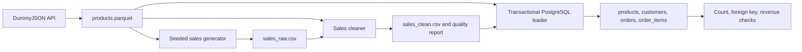

# E-commerce data pipeline

A university ETL project that fetches a product catalog from the DummyJSON REST API, creates reproducible synthetic sales, cleans them, and loads products and sales into PostgreSQL. The final runner verifies database counts, foreign keys, and revenue. Python 3.12 and Docker Compose work on Apple Silicon Macs; the `postgres:17` image supports ARM64.

## Architecture



## Installation and configuration

Install Python 3.12 and Docker Desktop with Compose, then from the repository root:

```bash
python3.12 -m venv .venv
.venv/bin/python -m pip install -r requirements.txt
cp .env.example .env
```

Edit `.env` to set local `POSTGRES_USER`, `POSTGRES_PASSWORD`, `POSTGRES_DB`, `POSTGRES_HOST`, and `POSTGRES_PORT`. The example uses host `127.0.0.1` and port `5433`. Choose your own password. `.env` is ignored by Git; never commit credentials. The Python loader reads `.env`, and Docker Compose uses it for the PostgreSQL container. If the persistent Docker volume was initialized with different credentials, use those credentials or an existing matching database; changing `.env` does not reset that volume.

## Start PostgreSQL and run the complete pipeline

```bash
docker compose up -d --wait
.venv/bin/python src/run_pipeline.py
```

The runner needs internet access to DummyJSON and a reachable PostgreSQL server. It checks the connection before loading and prints an actionable error if PostgreSQL is unavailable. Docker Compose retains data in the `postgres_data` volume. To stop the container without deleting its data, run `docker compose stop`.

The runner fetches 100 products into `data/raw/products.parquet`, generates sales with seed `20261122` into `data/raw/sales_raw.csv`, cleans them into `data/processed/sales_clean.csv`, and writes `data/processed/sales_quality_report.json`. It creates the schema and upserts all four tables in one transaction. Rerunning with the same source does not add duplicates: primary keys are stable, including an order-item key based on order, product, and sale price. Other data already in the database is preserved; total database counts and revenue can therefore exceed this run's source values.

Example output observed on 2026-11-22 with a fresh database (future API data may change the values):

```text
INFO Stage 1/6: Fetching products from DummyJSON
INFO Saved 100 products to .../data/raw/products.parquet
INFO Stage 2/6: Generating sales with seed 20261122
INFO Saved 185 raw sales rows to .../data/raw/sales_raw.csv
INFO Stage 3/6: Cleaning and validating sales
INFO Retained 173 sale lines; rejected 9 rows
INFO Stage 4/6: Checking PostgreSQL availability
INFO Stage 5/6: Loading PostgreSQL in one transaction
INFO Stage 6/6: Verifying counts, foreign keys, and revenue
INFO Pipeline complete

Execution summary
Products fetched: 100; raw sales rows: 185; cleaned sale lines: 173
Database rows: products=100, customers=28, orders=87, order_items=173
Foreign key orphan counts (orders/customers, items/orders, items/products): (0, 0, 0)
Total database sales revenue: 255375.79
Revenue from this run's sale lines: 255375.79
```

## Tests and SQL inspection

```bash
.venv/bin/python -m pytest -q
docker compose exec -T postgres sh -c 'psql -U "$POSTGRES_USER" -d "$POSTGRES_DB"' < sql/verify.sql
docker compose exec -T postgres sh -c 'psql -U "$POSTGRES_USER" -d "$POSTGRES_DB"' < sql/sales_by_product.sql
```

The database tests require PostgreSQL and create temporary schemas. They test idempotence, rollback, foreign keys, and revenue checks without clearing application data. The other tests cover generation and cleaning.

## Database schema

`sql/schema.sql` defines four tables. `products` stores the API catalog. `customers` stores customer identity and optional contact details. `orders` belongs to one customer and has an order date. `order_items` belongs to one order and one product, with quantity and historical unit sale price. Foreign keys prevent orphan orders and items. Monetary values use `NUMERIC`, and positive IDs and quantities have check constraints.

A demonstration query for revenue by product is in `sql/sales_by_product.sql`:

```sql
SELECT p.product_id, p.title,
       COALESCE(SUM(oi.quantity * oi.unit_price), 0)::NUMERIC(16, 2) AS total_sales
FROM products AS p
LEFT JOIN order_items AS oi ON oi.product_id = p.product_id
GROUP BY p.product_id, p.title
ORDER BY total_sales DESC, p.product_id;
```

## Git collaboration workflow

Create a feature branch for each stage, commit only source code and documentation, push the branch, and open a pull request. Have a teammate review it and run tests before merging. Pull the merged main branch before starting the next stage. Keep `.env`, virtual environments, and generated Parquet files out of commits; review `git status` and the diff before each commit. Stage 4 work stays on `feature/end-to-end-pipeline` until reviewed.

For a presentation walkthrough, see [docs/demo.md](docs/demo.md).
